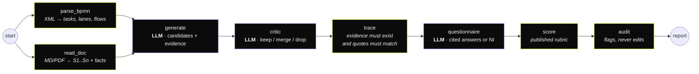

<div align="center">

# processlens · process-automation-agents

**A LangGraph pipeline that reads a BPMN process and its description, finds what to automate,
and proves every claim with evidence — then scores it with a rubric, not a vibe.**


**English** · [Português](README.pt-BR.md)


</div>

---

## What it does

Input: a **BPMN 2.0** model (Camunda / Bizagi / bpmn.io export) and the process
**description** (Markdown, text or PDF). Output: a ranked list of automation
candidates — each with the technique that fits (rules engine, document AI, LLM
triage, API integration, RPA, notification, decision support), the evidence
that supports it, a questionnaire with cited answers, and impact × feasibility
scores — as JSON, Markdown, a standalone HTML report and a **DOCX**.

## The pipeline



Violet = model call (one model per stage, structured JSON, bounded self-repair).
Lime = deterministic code. **Models propose; code decides** ([ADR 0001](docs/adr/0001-models-propose-code-decides.md)).

## What it demonstrates

- **Hallucination containment, mechanically.** Every evidence item must point to a BPMN
  element or sentence id that exists, and its quote must actually appear there
  (accent/case-folded, fuzzy ≥ 0.9). Candidates without both BPMN *and* description
  evidence are dropped. Tested with an adversarial provider that invents a candidate
  and cites a sentence that does not exist.
- **Explainable scoring.** The model only answers a fixed questionnaire with sentence
  ids — or `NI` (not informed). Impact and feasibility come from published weights
  (`stages/score.py`); every point is in `breakdown`. Same answers → same score.
- **Structured output that heals itself.** JSON-schema response format, Pydantic
  validation, validation errors fed back for up to *n* repairs, then a loud failure
  (`llm.OpenAICompatible`).
- **Model routing per stage** — generator and critic on different models (`PL_MODEL_<STAGE>`).
- **An independent auditor** that flags (automated human approvals, thin evidence,
  probabilistic steps in audited flows) without rewriting the proposal.
- **LangGraph used well**: typed state, additive reducers, parallel fan-out/fan-in, thin nodes.
- **Real document handling**: BPMN parsing with XXE/DTD rejection, PDF text extraction,
  bilingual (PT/EN) fact extraction (volumes with unit conversion, minutes/hours, systems,
  rule/exception/compliance signals), upload size limits.
- **Business-ready output**: priority matrix, DOCX for the people who live in Word.

## Quick start

```bash
git clone https://github.com/murilo-bassan/process-automation-agents.git
cd process-automation-agents
pip install -r requirements-dev.txt

python -m pytest                                  # 34 tests, ~2 s, fully offline
python -m processlens.cli samples/invoice-intake.bpmn samples/invoice-intake.md --out out
python -m uvicorn processlens.api:app --port 8810 # UI → http://localhost:8810 · OpenAPI → /docs
```

The UI switches between EN and PT-BR.

With a real model (any OpenAI-compatible endpoint — the key comes from your
environment, never from the repository):

```bash
export PL_PROVIDER=openai LLM_API_KEY=... PL_MODEL_GENERATE=... PL_MODEL_CRITIC=... PL_MODEL_QUESTIONNAIRE=...
```

## Samples (synthetic)

| Sample | Language | Tasks | Notes |
|---|---|---|---|
| `invoice-intake` | EN | 8 (1 already automated) | PDFs by e-mail, ERP with unused API, audited exceptions |
| `reembolso-viagem` | PT | 5 | spreadsheet + receipts, finance system without API |

| Candidate detail & cited questionnaire | Standalone HTML report |
|---|---|
|  |  |

## Decisions
- [0001 — Models propose, code decides](docs/adr/0001-models-propose-code-decides.md)
- [0002 — One model per stage, structured output with bounded repair](docs/adr/0002-one-model-per-stage.md)
- [0003 — LangGraph for orchestration, thin nodes](docs/adr/0003-langgraph-for-orchestration.md)

---

<sub>Part of an AI engineering portfolio — see [ai-engineering-portfolio](https://github.com/murilo-bassan/ai-engineering-portfolio). All processes and data are synthetic. MIT licensed.</sub>
