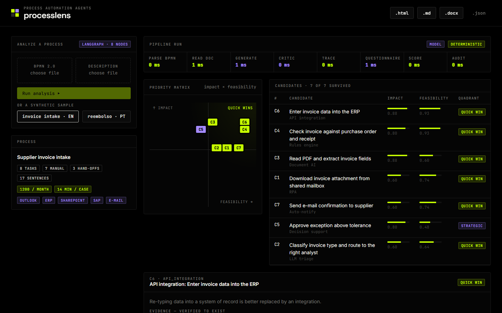
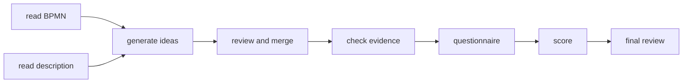
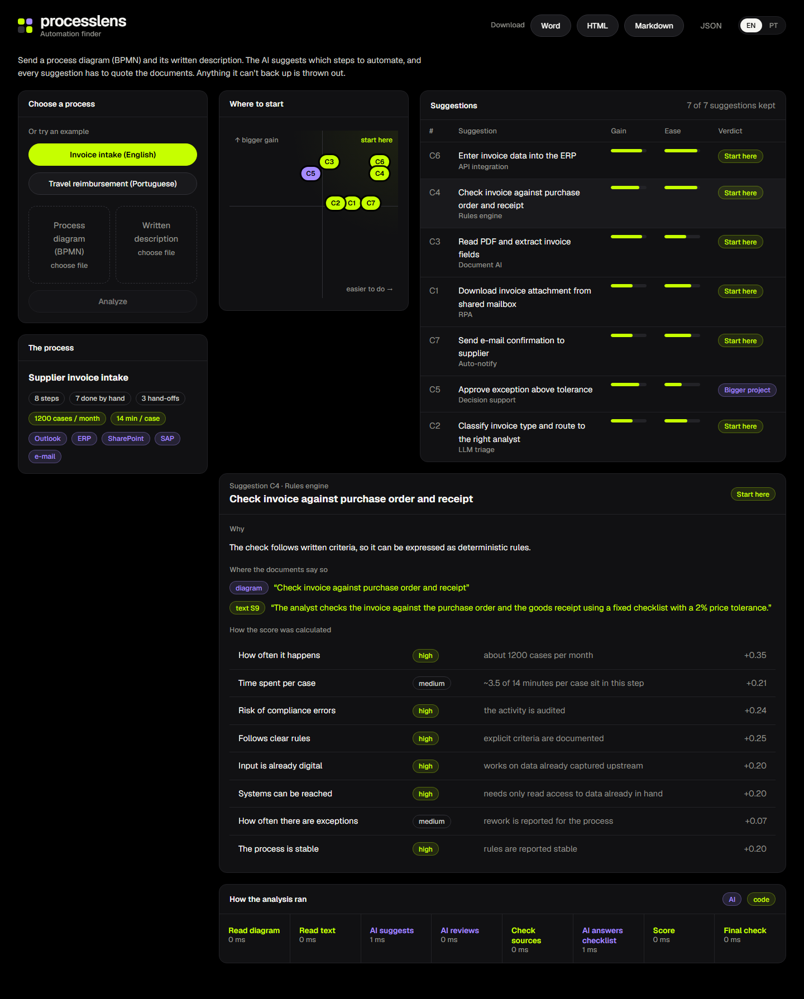
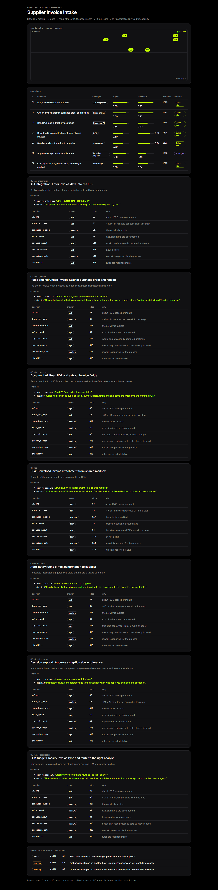

# processlens

**English** · [Português](README.pt-BR.md)

Reads a business process (a BPMN diagram plus its written description) and suggests what could be automated.
Each suggestion points to the part of the document that backs it up.



## How to use it

You send two files:

1. the process diagram in **BPMN** (exported from Camunda, Bizagi or bpmn.io);
2. the process **description**, in Markdown, plain text or PDF.

You get back a list of automation opportunities, most promising first. Each one comes with:

- the kind of solution that fits (rules, document AI, API integration, RPA, notifications and so on);
- the sentences and process steps that justify it;
- an impact score and a feasibility score, with the math shown.

The report comes out as Word, HTML, Markdown or JSON.

## Why you can trust the result

The model suggests, but code decides:

- **No source, no suggestion.** Every piece of evidence must point to a BPMN step or a sentence that really exists in the document, and the quoted text must match the original. Anything that doesn't check out is dropped.
- **The score isn't the model's guess.** The model only answers a fixed questionnaire, citing the sentences behind each answer (or "not stated"). The score comes from fixed weights in the code, so the same answers always give the same score.
- **A final review** flags things worth a second look, such as a human approval being automated away or weak evidence, without changing the suggestions.

## The steps



It's a LangGraph graph. The "generate", "review" and "questionnaire" steps use the model; the rest is plain code.

## Running it

```bash
git clone https://github.com/murilo-bassan/process-automation-agents.git
cd process-automation-agents
pip install -r requirements-dev.txt

python -m pytest
python -m processlens.cli samples/invoice-intake.bpmn samples/invoice-intake.md --out out
python -m uvicorn processlens.api:app --port 8810    # http://localhost:8810
```

There are two examples in `samples/`: invoice intake (English) and travel reimbursement (Portuguese).

Without configuration it runs on a deterministic reference model. To use a real LLM
(any OpenAI-compatible API):

```bash
export PL_PROVIDER=openai LLM_API_KEY=... PL_MODEL_GENERATE=... PL_MODEL_CRITIC=... PL_MODEL_QUESTIONNAIRE=...
```

You can use a different model for each step. Design decisions are in [`docs/adr`](docs/adr).

| One suggestion in detail | HTML report |
|---|---|
|  |  |

**Stack:** Python, LangGraph, Pydantic, FastAPI

The sample processes are made up. MIT license.
