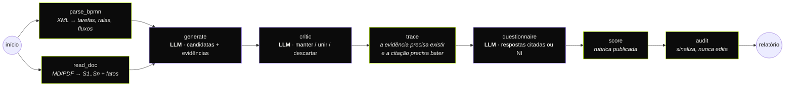

<div align="center">

# processlens · process-automation-agents

**Um pipeline LangGraph que lê um processo BPMN e sua descrição, encontra o que automatizar
e prova cada afirmação com evidência; depois dá a nota com uma rubrica, não no chute.**


[English](README.md) · **Português**


</div>

---

## O que faz

Entrada: um modelo **BPMN 2.0** (exportado do Camunda, Bizagi ou bpmn.io) e a
**descrição** do processo (Markdown, texto ou PDF). Saída: uma lista ranqueada
de candidatas à automação. Cada uma vem com a técnica adequada (motor de regras,
IA documental, triagem por LLM, integração por API, RPA, notificação, apoio à
decisão), as evidências que a sustentam, um questionário com respostas citadas
e as notas de impacto × viabilidade, em JSON, Markdown, relatório HTML
independente e **DOCX**.

## O pipeline



Violeta = chamada de modelo (um modelo por estágio, JSON estruturado, autocorreção limitada).
Verde-limão = código determinístico. **O modelo propõe; o código decide** ([ADR 0001](docs/adr/0001-models-propose-code-decides.md)).

## O que demonstra

- **Contenção de alucinação, por mecanismo.** Toda evidência precisa apontar para um
  elemento do BPMN ou um id de sentença que existe, e a citação precisa aparecer lá de
  verdade (sem diferenciar acento e maiúsculas, similaridade ≥ 0,9). Candidatas sem
  evidência no BPMN *e* na descrição são descartadas. Testado com um provedor adversário
  que inventa uma candidata e cita uma sentença inexistente.
- **Nota explicável.** O modelo só responde um questionário fixo citando ids de sentença,
  ou `NI` (não informado). Impacto e viabilidade saem de pesos publicados
  (`stages/score.py`); cada ponto aparece em `breakdown`. Mesmas respostas → mesma nota.
- **Saída estruturada que se corrige.** Formato de resposta via JSON Schema, validação
  Pydantic, erros de validação devolvidos ao modelo por até *n* correções e, depois disso,
  falha explícita (`llm.OpenAICompatible`).
- **Roteamento de modelo por estágio**: gerador e crítico em modelos diferentes (`PL_MODEL_<ESTÁGIO>`).
- **Um auditor independente** que sinaliza (aprovação humana automatizada, evidência fraca,
  passos probabilísticos em fluxos auditados) sem reescrever a proposta.
- **LangGraph bem usado**: estado tipado, reducers aditivos, ramos paralelos que se juntam, nós enxutos.
- **Documentos de verdade**: leitura de BPMN com rejeição de XXE/DTD, extração de texto de PDF,
  extração bilíngue (PT/EN) de fatos (volumes com conversão de unidade, minutos/horas, sistemas,
  sinais de regra, exceção e conformidade), limite de tamanho de upload.
- **Saída pronta para o negócio**: matriz de prioridade e DOCX para quem vive no Word.

## Como rodar

```bash
git clone https://github.com/murilo-bassan/process-automation-agents.git
cd process-automation-agents
pip install -r requirements-dev.txt

python -m pytest                                  # 34 testes, ~2 s, totalmente offline
python -m processlens.cli samples/invoice-intake.bpmn samples/invoice-intake.md --out out
python -m uvicorn processlens.api:app --port 8810 # interface → http://localhost:8810 · OpenAPI → /docs
```

A interface tem opção PT-BR/EN.

Com um modelo real (qualquer endpoint compatível com OpenAI; a chave vem do seu
ambiente, nunca do repositório):

```bash
export PL_PROVIDER=openai LLM_API_KEY=... PL_MODEL_GENERATE=... PL_MODEL_CRITIC=... PL_MODEL_QUESTIONNAIRE=...
```

## Exemplos (sintéticos)

| Exemplo | Idioma | Tarefas | Observações |
|---|---|---|---|
| `invoice-intake` | EN | 8 (1 já automatizada) | PDFs por e-mail, ERP com API sem uso, exceções auditadas |
| `reembolso-viagem` | PT | 5 | planilha + comprovantes, sistema financeiro sem API |

| Detalhe da candidata e questionário citado | Relatório HTML independente |
|---|---|
|  |  |

## Decisões (em inglês)
- [0001 — O modelo propõe, o código decide](docs/adr/0001-models-propose-code-decides.md)
- [0002 — Um modelo por estágio, saída estruturada com correção limitada](docs/adr/0002-one-model-per-stage.md)
- [0003 — LangGraph para orquestração, nós enxutos](docs/adr/0003-langgraph-for-orchestration.md)

---

<sub>Parte de um portfólio de engenharia de IA: veja [ai-engineering-portfolio](https://github.com/murilo-bassan/ai-engineering-portfolio). Todos os processos e dados são sintéticos. Licença MIT.</sub>
