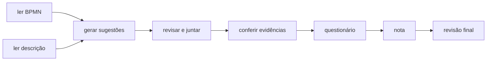

# processlens

[English](README.md) · **Português**

Lê um processo de negócio (o diagrama BPMN e a descrição escrita) e sugere o que dá para automatizar.
Cada sugestão aponta o trecho do documento que a justifica.


## Como usar

Você envia dois arquivos:

1. o diagrama do processo em **BPMN** (exportado do Camunda, Bizagi ou bpmn.io);
2. a **descrição** do processo, em Markdown, texto ou PDF.

E recebe uma lista de oportunidades de automação, da mais para a menos promissora. Cada uma vem com:

- o tipo de solução indicado (regras, leitura de documentos com IA, integração por API, RPA, notificação etc.);
- as frases e etapas do processo que justificam a sugestão;
- uma nota de impacto e de viabilidade, com o cálculo aberto.

O relatório sai em Word, HTML, Markdown ou JSON.

## Por que dá para confiar no resultado

O modelo sugere, mas quem decide é o código:

- **Sem fonte, sem sugestão.** Toda evidência precisa apontar para uma etapa do BPMN ou uma frase que existe de verdade no documento, e o trecho citado precisa bater com o original. O que não confere é descartado.
- **A nota não é chute do modelo.** O modelo só responde um questionário fixo, citando as frases de onde tirou cada resposta (ou "não informado"). A nota sai de pesos fixos no código, então as mesmas respostas sempre dão a mesma nota.
- **Uma revisão no final** sinaliza pontos de atenção, como aprovação humana sendo automatizada ou evidência fraca, sem alterar as sugestões.

## As etapas



É um grafo LangGraph. As etapas "gerar", "revisar" e "questionário" usam o modelo; as outras são código comum.

## Rodando

```bash
git clone https://github.com/murilo-bassan/process-automation-agents.git
cd process-automation-agents
pip install -r requirements-dev.txt

python -m pytest
python -m processlens.cli samples/invoice-intake.bpmn samples/invoice-intake.md --out out
python -m uvicorn processlens.api:app --port 8810    # http://localhost:8810
```

Há dois exemplos em `samples/`: recebimento de notas fiscais (em inglês) e reembolso de viagem (em português).

Sem configuração, roda com um modelo de referência determinístico. Para usar um LLM de verdade
(qualquer API compatível com a da OpenAI):

```bash
export PL_PROVIDER=openai LLM_API_KEY=... PL_MODEL_GENERATE=... PL_MODEL_CRITIC=... PL_MODEL_QUESTIONNAIRE=...
```

Dá para usar um modelo diferente em cada etapa. As decisões de projeto estão em [`docs/adr`](docs/adr).

| Detalhe de uma sugestão | Relatório HTML |
|---|---|
|  |  |

**Stack:** Python, LangGraph, Pydantic, FastAPI

Os processos de exemplo são fictícios. Licença MIT.
